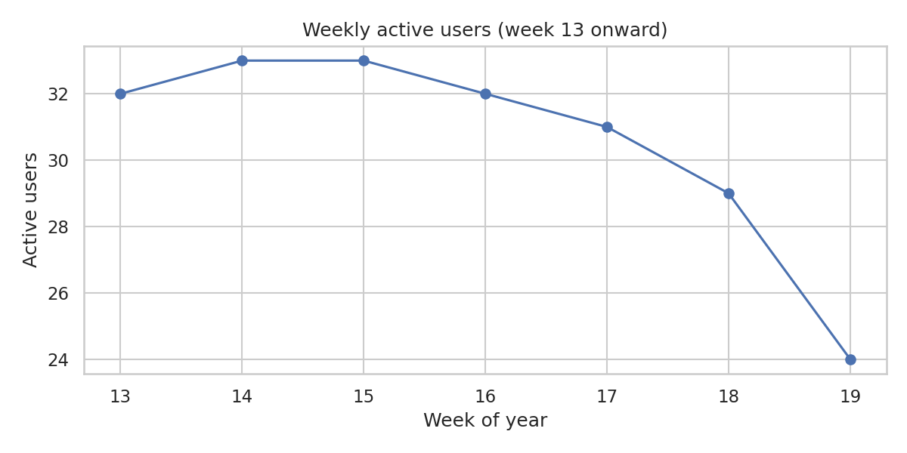
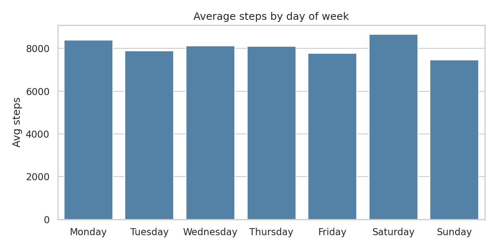
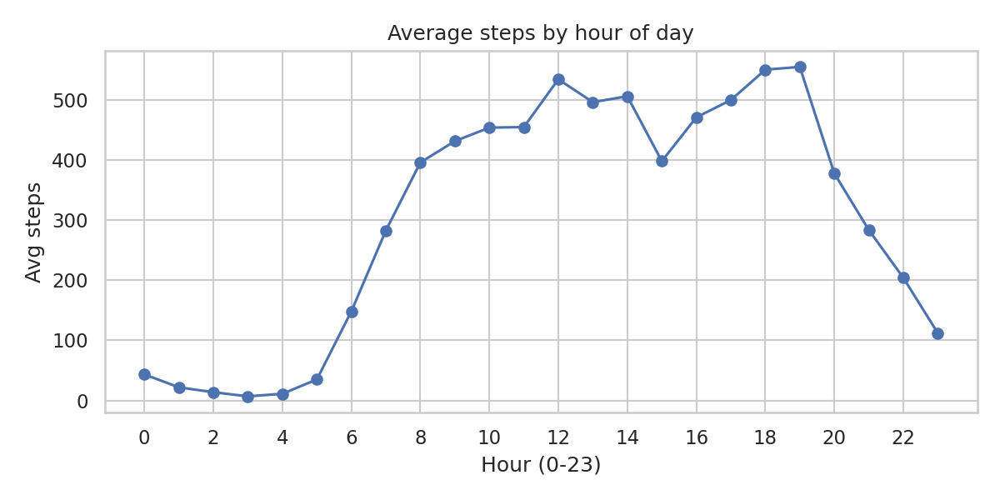
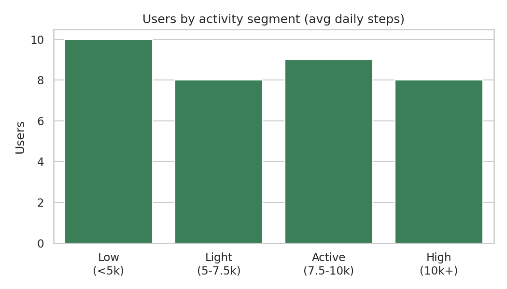
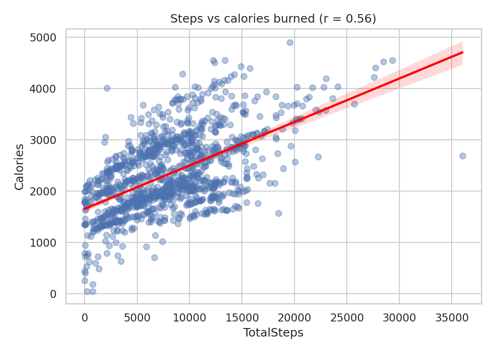

# Fitness Tracker Engagement Analysis

> How do users engage with a fitness tracker, when are they most active, and where does engagement fall off? An exploratory analysis of 35 users over 62 days using Python and SQL.

## Business problem

A fitness-tech product team wants to understand how users engage with their wearable day to day, which user segments exist, and when to intervene to keep people active. This analysis answers four questions:

1. How consistently do users wear and use the tracker?
2. Does engagement drop over time?
3. When (day and hour) are users most active?
4. What distinct activity segments exist among users?

## Data

- **Source:** [Fitbit Fitness Tracker Data](https://www.kaggle.com/datasets/arashnic/fitbit) (Kaggle, by Möbius), public survey data from 2016
- **Files used:** `dailyActivity_merged.csv` and `hourlySteps_merged.csv` from both collection periods
- **Size after cleaning:** 1,373 daily records and about 46,000 hourly records across **35 users**
- **Period:** 12 March to 12 May 2016 (62 days)
- **Limitations:** a small sample, and the data comes from volunteers, so results are **exploratory** and should not be generalised to a wider population

## Approach

1. **Cleaning (Python/pandas):** combined the two collection periods, converted date types, removed 24 duplicate daily rows and 175 duplicate hourly rows caused by overlapping dates, and flagged 138 zero-step days (about 10%) as likely non-wear days
2. **Analysis (SQL on SQLite):** engagement per user, weekly active users, day-of-week and hour-of-day patterns, and user segmentation with CTEs and `CASE` logic
3. **Visualisation (Matplotlib/Seaborn)**

**Decision on zero-step days:** treated as non-wear days. They are excluded from activity averages but counted when measuring engagement.

## Key findings

**1. Engagement drops in the final weeks.**
Weekly active users peaked at 33 and fell to 24 by the last week, a decline of about 27% (the final week is partial, so treat that figure with care). The first three weeks were excluded because only 1 to 4 users had joined.



**2. Saturday is the most active day and Sunday the least.**
Users averaged about 8,667 steps on Saturday against 7,457 on Sunday, so Sunday is roughly 14% lower than Saturday.



**3. Activity peaks at 6 to 7 pm, with a smaller lunchtime peak.**
Average hourly steps are highest at 6 to 7 pm (about 550 to 555), with a secondary peak at noon (about 534). Activity is near zero from midnight to 5 am and falls sharply after 8 pm.



**4. Users fall into four clear segments.**
Highly active users (10,000+ steps/day) average about 3.2x the steps of low-activity users (under 5,000). Low-activity users make up 29% of the base (10 of 35 users).

| Segment | Users | Avg daily steps |
|---|---|---|
| Low (<5k) | 10 | 3,817 |
| Lightly active (5k to 7.5k) | 8 | 6,394 |
| Active (7.5k to 10k) | 9 | 8,621 |
| Highly active (10k+) | 8 | 12,348 |



**5. More steps relate to more calories burned, but steps alone are not the full story.**
The correlation between daily steps and calories is moderate (**r = 0.56**), so steps explain only about 31% of the variation in calories burned. The visible bands in the chart suggest that individual differences such as body size matter a lot. A few outliers, such as one day with about 36,000 steps and only about 2,700 calories, may be tracking errors.



## Recommendations

1. **Time nudges for the evening window (about 6 pm).** That is when users are naturally most active, so prompts and challenges are most likely to land.
2. **Run a re-engagement campaign for the low-activity segment.** They are 29% of users and average under 4,000 steps, well below the other groups.
3. **Target Sunday specifically.** It is the weakest day, so weekly goals or Sunday challenges could lift it.
4. **Watch late-period retention.** The decline in the final weeks should be tracked over a longer period to confirm whether it is a real trend.

## Tools

Python (pandas, NumPy, Matplotlib, Seaborn), SQL (SQLite), Google Colab, Git/GitHub

## Repository structure

```
├── notebooks/
│   ├── 01_cleaning.ipynb
│   └── 02_sql_analysis.ipynb
├── sql/analysis_queries.sql
├── images/
├── requirements.txt
└── README.md
```

## How to reproduce

1. Download the dataset from the Kaggle link above
2. Open `notebooks/01_cleaning.ipynb` in Google Colab, upload the activity and hourly steps files, and run all cells
3. Open `notebooks/02_sql_analysis.ipynb`, upload the cleaned CSVs and run all cells

## Author

**Raghav Siddharth**, Data Analyst · [LinkedIn](https://www.linkedin.com/in/raghav-siddharth-18207b295) · [Portfolio](https://raghavxi1.github.io/raghav-portfolio/)
